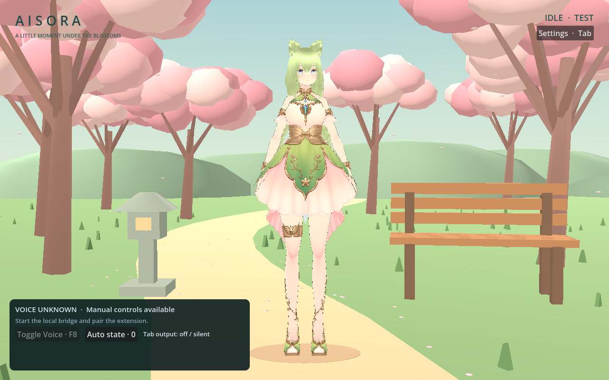
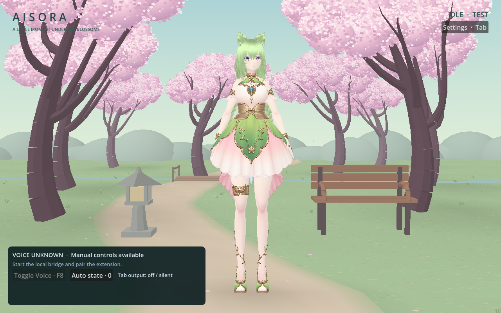

# Phase 3: softer sakura scenery and less render work

Historical Phase 3 notes. [Phase 4](PHASE4.md) adds the current hybrid mode and keeps this 3D park as an optional fallback.

Update your existing `dev/aisora-companion` checkout and reopen `project.godot` in **Godot 4.6.3, Compatibility**. Allow the new SVG textures/shaders to import, then Run Project (F5). No new runtime packages, paid services, extension reinstall or bridge configuration are required. Existing camera, audio, shortcut, intensity and particle preferences are retained.

```sh
git switch dev/aisora-companion
git pull --ff-only
```

## What changed

The reference guides the pink canopy, open foreground, curved branches, winding path and pale layered distance. Original baked blossom art replaces polygonal foliage balls; eight trees share one cutout-textured canopy batch. Trunks taper along curved paths, with smaller forked twigs. Soft grass marks, baked contact/dappled shade and feathered path colors add ground detail. A smaller slatted bench, stone lantern, distant bridge/stream, grass tufts and fallen blossoms share a few static surfaces. Aisora remains in the center with an open silhouette.

| Phase 2 | Phase 3 Low |
| --- | --- |
|  |  |

All geometry is built once. Blossom cards use depth-writing alpha cutouts, not blended particle clouds. Colors and soft shade are baked into textures/vertices; there are no dynamic shadow maps, GI, bloom, SSAO, reflections or moving vegetation shaders. The sparse falling petals use one instanced mesh and analytic vertex motion: no CPU particle loop, per-frame transform upload or spawn allocations. Pause/resume adjusts shader time once and avoids catch-up work.

Low and Balanced retain every original character albedo texture with a one-sample stylized shader. They omit the imported multi-texture/per-light MToon shading and outline passes. **High restores the exact imported materials/outlines**, with 2× MSAA. The Lighting setting adjusts efficient character brightness; scenery uses baked shade. Efficient materials approximate the lighting; they do not reproduce every MToon feature. The VRM file and importer are unchanged.

The animation controller caches rest-axis quaternions, joint limits and facial bindings, reuses layer dictionaries, and skips unchanged native bone/blendshape writes. It updates the four owned facial layers rather than clearing every imported expression every frame. Primary breathing, posture, gestures, blinking, state transitions and amplitude lip sync remain active each rendered frame. Only small hair-root and eye-bone motion runs at a lower frequency. Full hair springs remain disabled.

## Choose a preset

Open **Settings (Tab)**. Low is the default and recommended starting point for the 2017 Intel iMac. Existing Lightweight preferences become Low; existing Standard preferences become High, preserving the user's prior choice. The new preset is saved independently, and unknown settings are preserved.

| Setting | Low | Balanced | High |
| --- | --- | --- | --- |
| Character | Efficient textured shading | Efficient, slightly stronger soft shading | Original MToon + outlines |
| MSAA | Off | Off | 2× |
| Blossom cards / grass tufts, maximum | 64 / 64 | 80 / 120 | 96 / 180 |
| Falling petal cap | 24 | 40 | 56 |
| Hair/eye update rate | Up to 8 Hz | Up to 12 Hz | Up to 12 Hz |
| Primary expressions/motion | Every render frame | Every render frame | Every render frame |

Low-power mode uses Low's rendering cost, at most 12 petals, six hair roots and a **15 FPS** cap without losing the selected preset. All modes target **30 FPS** by default. The foreground slider still permits 15–60. Inactive windows cap at 10 FPS, minimized windows at 5 FPS, and settled sleep at 10 FPS. Inactive/minimized decorative petals pause; secondary character motion drops to at most 4 Hz. State and mouth updates still follow fresh Voice/audio input. Sleep/wake easing, gesture variation and manual previews are preserved.

The normal opaque, resizable window remains the default. No desktop overlay, wandering behavior or extra runtime dependency is introduced. Background throttling never sends a Voice-end command or stops the bridge/browser. Native Voice, permissions and macOS event delivery still require real-device testing.

## Inspect performance locally

Press **F3** (Fn+F3 if macOS reserves F3) or enable **FPS / frame-time overlay** in Settings. It shows a rolling window of the latest 120 frame intervals: measured FPS, mean milliseconds per frame, p95, engine process time, draw calls and the active cap. The display refreshes twice per second; storage is bounded. Mean/p95 include cap waits and system stalls, so this is a pacing diagnostic, not GPU timing. At steady 30 FPS aim for about **33.3 ms**, or **66.7 ms** at 15 FPS. A short startup spike ages out of the rolling window.

1. Start with Low, 30 FPS, a normal 1120×700 window. Close the editor's running preview when testing another instance. Let imports/shaders warm up.
2. Show F3; watch Idle for a minute, then preview Wave/Stretch and test Listening, Talking with synthetic amplitude, Sleeping and Waking. Look for repeated p95 spikes, stutters and clipping. Switch the synthetic test off afterward.
3. Compare Low/Balanced/High at the same window size. On an older Intel GPU, keep Low if High causes missed frames. Try Low-power 15 FPS and compare Activity Monitor CPU/memory and responsiveness. Reduce window size or particle density if needed.
4. During a real browser Voice call, switch apps/minimize for a minute, then restore. Verify uninterrupted audible Voice, fresh connection/audio status, responsive mouth animation and restored foreground pacing. macOS focus/minimize events are not certified by simulated flags.
5. Exercise your existing camera, lighting, audio and shortcut preferences, close/reopen, and confirm they persist. F3 and its checkbox should agree.

[PERFORMANCE.md](PERFORMANCE.md) contains the controlled cloud before/after measurements, raw results and exact reproduction commands. Software-rendered cloud figures **do not establish 30 FPS on the target iMac**. Sustained iMac frame pacing, thermals, macOS wake/minimize behavior and native consumer Voice remain untested here.

## Developer validation

```sh
./tools/check.sh
# Requires a display and Godot Compatibility:
./tools/run_godot.sh --audio-driver Dummy --script res://tests/render_phase3.gd
./tools/run_godot.sh --audio-driver Dummy --script res://tools/capture_preview.gd -- --sheet
```

The core suite covers actual VRM poses/textures, animated sleep/wake, silence, randomized gestures, presets/material restoration, secondary update intervals, diagnostics, settings migration/restart, rendering limits and actual Godot/HTTP integration with simulated browser audio. The rendered test compares real GL frames to verify petal motion/pause and character visibility in all presets. Screenshots/logs stay under ignored `.local/`. Run `python3 tools/bake_park_assets.py` only to regenerate the original checked-in SVG artwork; Python is not needed for scenery at runtime.
