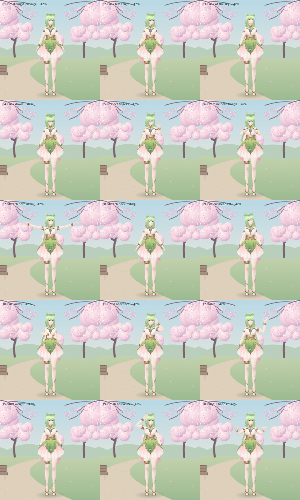

# Phase 4: illustrated park, 3D Aisora and Voice recovery

Continue using `dev/aisora-companion` and **Godot 4.6.3 Compatibility**. Update your existing checkout, allow imports to finish and Run Project (F5). No new runtime package, paid API or asset download is needed. The original VRM, textures, skeleton, efficient materials, graphics presets, F3 diagnostics, resizable window and 30/15/10/5 FPS policies remain.

```sh
git switch dev/aisora-companion
git pull --ff-only
```

## Load your preferred background

You selected **the first image, with the path and benches**. Its pixels are visible in chat but were not exposed as a downloadable file in the cloud workspace. The repository therefore contains **an original placeholder illustration**, not a copy of either supplied picture. Save your permitted local copy on your Mac, then:

1. Open Settings (Tab) and scroll to **Illustrated scenery**.
2. Click **Choose local park image…** and choose your first image (PNG, JPEG or WebP). Successful loading selects **Illustrated background + 3D Aisora**. Failed replacement keeps the existing scenery.
3. Adjust **Character scale**, **horizontal position** and **ground position** to put her feet on the path. Adjust the existing camera distance/height and Lighting if desired. Scale is uniform; changing window aspect does not stretch Aisora or the picture.
4. Optionally choose a separate **transparent foreground** PNG/WebP. It is not extracted from or painted into your photograph. Use the original simple branch overlays otherwise, or turn scenery animation off.

Imported images are copied only to Godot's local `user://aisora-background.png` / `aisora-foreground.png`, **outside Git**. The original file is untouched. Do not redistribute pictures without permission; background paths/images and pairing secrets are not committed. No web image search or download is performed.

Images are checked before bitmap allocation: maximum 20 MiB, 16 megapixels and 8192 pixels per edge. A local copy keeps up to 1920 pixels on its long edge; GPU background textures use at most 1280 / 1600 / 1920 for Low / Balanced / High. Foreground textures use at most 512. Aspect is preserved throughout. The background uses centered cover scaling: it fills the window by cropping edges, with no nonuniform stretch. Source photos that are already low resolution remain low resolution.

## How the layers work

Godot's native **Environment.BG_CANVAS** draws the canvas artwork behind the existing 3D world. Aisora remains the imported, lit, skinned mesh in that world. This is a layered technique supported by the tested Compatibility renderer; **no second full-window SubViewport or duplicate character render is needed**. A separate soft 2D ground shadow follows her projected foot anchor. UI and optional foreground effects draw above the 3D character.

The **Original 3D park fallback** setting restores Phase 3 staging, camera-relative proportions, lighting and park effects. Its geometry/textures build only when selected, then remain available for switching back. Hidden fallback petals stop. The old park is retained and tested, not removed from the project.

Scenery has independent controls:

| Control | Behavior |
| --- | --- |
| Scenery animation intensity | Branch sway, petal motion and gentle background light variation; 0 hides all animated overlays |
| Petal density | Off at 0; maximum 24 / 32 / 40 in Low / Balanced / High, or 12 in low-power |
| Slow background parallax | Optional small rigid translation with overscan; no UV warp, bending or distortion of the background |
| Inactive/minimized window | Shader time and parallax pause; Voice processing continues |

Petals are one instanced 2D mesh with static seeds/transforms and vertex motion. Branch sway also runs at vertices. Ambient variation reuses the background texture draw, computes its slow sine at vertices, and needs no extra full-window tint pass. Character lighting remains independent. There is no CPU particle simulation or full-image displacement shader. Parallax updates at most 10 Hz only when enabled and focused.

## Actions and honest limits

Settings → **Standing actions** provides previews, a weighted scheduler, minimum/maximum waiting intervals and a random weight per action (0 disables automatic selection). Intervals are the pause **after an action completes**; defaults are 8–15 seconds. Previews still work with random actions disabled. The scheduler avoids an immediate repeat when multiple actions are enabled; a single enabled action can repeat after its interval.

**Fifteen of the requested actions are implemented**, with the existing standing rest/wake transition retained. This is not a claim that all 20 requested actions work. Numbers below match the original request and the preview menu.

| Request | Implemented behavior / status |
| --- | --- |
| 1. Breathing/posture | Deeper breath/shoulder rise over continuous micro movement |
| 2. Look left/right | Timed head/neck sweep in both directions |
| 3. Look up | Head/neck tilt toward the sky |
| 4. Look down | Head/neck bow |
| 5. Inspect fingers | Raised hand, focused head angle and actual index/middle joint articulation |
| 6. Examine hands | Both hands forward and separate, with wrist movement and downward gaze |
| 7. Stretch arms | Both arms raise outward/upward |
| 8. Stretch back | Spine/chest arch and head recovery |
| 9. Curious tilt | Distinct eased head tilt |
| 10. Fold arms | Crossed forearms at staggered heights in front of the torso |
| 11. Hand near face | Bent elbow brings the hand beside the face |
| 12. Wave | Existing raised forearm/wrist wave |
| 13. Turn around | **Unavailable**: no validated foot pivots; a torso/root spin is not presented as a turn |
| 14. Steps | **Unavailable**: no validated gait, foot IK/contact or skirt behavior; no sliding root translation |
| 15. Weight shift | In-place hip/torso shift with small leg/foot counter-rotations |
| 16. Sit | **Unavailable**: no validated seated transition/cloth pose or calibrated 3D seat in an arbitrary image |
| 17. Lie down | **Unavailable**: no validated floor-contact/cloth transition |
| 18. Wake/stand | **Standing rest/wake only**: press 5 to settle, then 1/0 to wake. Rising from a seat/floor is unavailable |
| 19. Brush hair | Hand reaches the temple/crown with a small brushing sweep |
| 20. Playful hands | Both hands raised with alternating wrist gestures |



The hand targets were authored against the actual imported skeleton. Joint poses use cached rest-axis conversion and eased entry/exit; the whole character is not rotated/translated to pretend to sit, lie or walk. Continuous breathing, blinking and appropriate facial/micro motion remain between actions. Finger contact and cloth collisions are approximations, not a physical collision solver. Visual inspection samples transitions and peaks on this VRM; arbitrary replacement clothing is not certified.

During active or pending Voice, long idle previews/scheduling are blocked and an ongoing idle gesture fades out. Listening/talking retain small conversational nods/gestures. If metadata is lost after known active Voice, the animation guard stays conservative until a confirmed inactive state or **Voice ended manually · resume idle actions**. That button only releases the local guard; it never ends a browser call. Use it only after ending Voice manually. Explicit 1–5 test-state controls remain intentional manual overrides; 0 resumes automatic presentation.

## Update and pair Voice on macOS

1. Keep your existing ChatGPT browser session/conversation. Finish an active call before updating the unpacked extension. In Chrome/Edge 116+, reload the extension from `browser-controller/extension` (version 0.2.0); reselect your existing conversation afterward. If old content scripts remain, refresh that same tab after ending the call. The app never navigates, opens a new chat or extracts browser authentication.
2. Run `tools/start_bridge.command` from the checkout using Python 3.10+. Keep that Terminal open. The bridge listens only on 127.0.0.1 and keeps the local pairing key across restarts. No pip packages or ChatGPT/API secret are needed.
3. In the extension choose `.local/bridge.json`, then **Use this ChatGPT tab**. Chrome verifies bridge identity **and authenticated state access before replacing a working pairing**. A health response alone is insufficient.
4. Godot normally reads the checkout's pairing file. For an exported viewer or another location, Settings → **Voice connection → Choose bridge pairing file…** accepts that file; only its path is saved in settings. `AISORA_BRIDGE_CONFIG` remains supported when no saved override is selected. Rejected keys show an actionable status and do not end native Voice.
5. Start/end Voice in ChatGPT manually, or use the extension/Godot's explicit **Start Voice / End Voice** controls. F8/F9 and the toggle remain. Repeated absolute Start observes the existing active state without clicking Start again. Pending commands and short client debounce prevent rapid duplicate attempts; unconfirmed dispatched commands are not replayed automatically.
6. For lip sync, explicitly click **Capture this tab's output audio** in the extension while on the selected tab and approve normal browser permissions. Only scalar output RMS is sent locally. No microphone audio, recordings, transcript, cookie or account token is read/sent. Capture reconnects after worker suspension and refuses samples from another tab.
7. If microphone access is blocked, allow ChatGPT microphone access in Chrome's site permissions and macOS Privacy & Security → Microphone for your browser. The extension does not dismiss or bypass permission prompts. Capture denial/ended messages leave manual Voice usable; retry capture explicitly after fixing permissions.

The footer separates **Bridge online/offline**, browser connection and detected Voice state. Automatic Talking follows fresh output amplitude. Thinking requires an explicit visible Voice thinking indicator (or a user-configured CSS selector for that indicator); silence does not imply Thinking. Otherwise an active Voice session uses attentive Listening presentation. These presentation states do not prove microphone reception or reveal the model's internal state.

Only fixed diagnostic codes leave the page. Default permission/thinking markers are conservative, experimental UI selectors, not a guarantee of current native ChatGPT markup. They may be absent or localized; the advanced popup allows CSS overrides for start/end/thinking. If detection is unavailable, use ChatGPT's own controls and manual presentation states (2 Listening / 3 Thinking / 4 Talking, with capture for amplitude).

The extension refuses selection of another conversation while an **observed** Voice owner may still be active. End that session first. **Voice ended manually · clear stale guard** is an explicit recovery option for uncertain stale state; it sends no Voice command. The guard cannot know about every session manually started in unselected tabs or across a browser/extension restart. No automatic session opening or retries are performed. Browser control and audio stay separate from Godot rendering; the 5 FPS HTTP test verifies fresh metadata with a simulated browser, not native consumer Voice.

## Test locally and remaining limits

Start at **Low, 30 FPS**, in a normal window. F3 (Fn+F3 if reserved by macOS) shows mean/p95 frame intervals; try 15 FPS low-power if needed. Check the first supplied background through the local picker, different aspect ratios, character scale/foot placement, shadow and effects off/on. Switch to the 3D fallback and back. Preview each supported action and standing sleep/wake; verify there are no sudden poses or skirt/hand collisions at your intensity setting.

Test native Voice start/end twice in the **same** authenticated conversation, microphone-denied recovery, capture/retry/stop and worker/bridge reconnection. Minimize/switch apps during a real call, then restore; audible Voice should continue independently, while status/mouth recover. Do not update/reload the extension during a live call. See [SETUP_MAC.md](SETUP_MAC.md) for full original setup and optional global hotkeys.

[Phase 4 performance evidence](PERFORMANCE_PHASE4.md) compares against Phase 3. All cloud figures use software OpenGL and the original placeholder artwork. The supplied image files, native authenticated Voice, real audio/permission prompts, native Mac file dialogs, macOS focus/minimize/hotkeys, export and sustained 2017 iMac performance/thermals remain **untested on the target device**. No 30 FPS iMac guarantee or full native Voice support is claimed.

```sh
./tools/check.sh
# Display required; Compatibility functional render checks:
./tools/run_godot.sh --audio-driver Dummy --script res://tests/render_phase4.gd
./tools/run_godot.sh --audio-driver Dummy --script res://tests/render_phase3.gd
# Original-art screenshots of supported actions (never user pictures):
./tools/run_godot.sh --audio-driver Dummy --script res://tools/capture_actions.gd
# Optional simulated DOM; requires developer Playwright + local Chromium:
python3 tests/browser_smoke.py --chromium /usr/bin/chromium
```
